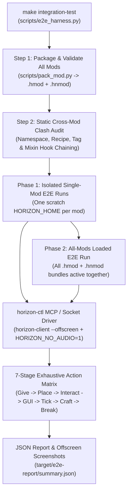

# End-to-End Horizon Mod Integration & Compatibility Harness Plan

## 1. Objective

Provide an automated integration test harness invoked via `make` (`make e2e-mod MOD=<id>` and `make e2e-all-mods` / `make integration-test`) that:
1. **Phase 1 (Isolated Mod Verification)**: Boots the real **Horizon** application (`horizon-client` driven by `horizon-ctl` in offscreen/headless mode) with a single mod loaded, spawns all of its blocks and items into a test world, and executes **every possible action** (placement, item-on-block interactions, GUI screen opening, custom button clicks, slot transfers, hopper/neighbor ticking, crafting recipes, and survival block breaking/loot drops).
2. **Phase 2 (All-Mods Compatibility Matrix)**: Boots `horizon-client` with **every Rekkit mod loaded simultaneously**, places all blocks from all mods into a shared world across dedicated test plots, and re-runs the exhaustive action suite plus cross-mod interaction tests to guarantee zero namespace clashes, hook shadowing bugs, recipe collisions, or tick regressions.

---

## 2. Architecture & Horizon Engine Integration

Horizon ships a built-in automation controller (`horizon-ctl`, used by [`horizon/tools/agent_control_e2e.py`](file:///Users/jonathanstoff/Desktop/scripts/rekkit/horizon/tools/agent_control_e2e.py)) that connects to a running `horizon-client` instance over a Unix domain socket (`--socket <work>/c.sock`) using CLI commands or JSON-RPC (`horizon-ctl mcp`).



### Runtime Environment

A live run (`make e2e-mod`, `make e2e-all-mods`, `make integration-test`) does every setup step itself; `make e2e-setup` stops after the build.

1. **Submodule.** Initialises `./horizon` if it is empty and runs `git fetch origin` in it so pinned commits exist. Your own checkout of `horizon/` is never moved or modified.
2. **Source.** `git archive` of the build revision into `target/e2e/source/<rev>/` (links dropped, as the launcher does). The revision is `--horizon-rev` / `REV=`: `pinned` (default: the newest `horizon` the selected mods pin in `native/horizon-native.json`), `submodule` (the checked-out commit), `latest` (`origin/main`) or a SHA.
3. **Native mixins.** `horizon-mixins` is built once at the mods' pinned `mixins` revision (`target/e2e/tools/<rev>/`). Every selected mod's `native/mixins/<id>/` bundle is copied, repinned to the build revision, and applied with `horizon-mixins apply`; the result is synced into `target/e2e/stage/<rev>/` copying only changed files.
4. **Build.** `cargo build --locked --profile fast [--features horizon-client/mods] -p horizon-client --bin horizon-client --bin horizon-ctl` with `CARGO_TARGET_DIR=target/e2e/cargo-target/<rev>`. Binaries are cached in `target/e2e/bin/<rev>-<bundle hash>/`; `--rebuild` ignores the cache. Log: `target/e2e/build.log`.
5. **Resources.** Prepared game resources from your own Minecraft: Java Edition 26.3 (`horizon/.local/horizon-client/26.3/horizon-resources.json`). Horizon never downloads Minecraft. `--prepare --server-jar PATH` runs `horizon-prepare` when they are missing.
6. **Isolated game home.** Each session gets a fresh temporary `HORIZON_HOME` (plus scratch `HORIZON_LAUNCHER_HOME`, `XDG_DATA_HOME`, `XDG_CONFIG_HOME`) containing:
   * `.local/horizon-client/26.3` → the prepared resources
   * `horizon-mods/<id>.hmod` and `horizon-mods.txt` with `mod.<id>:true` for each selected mod
   * `horizon-extras.txt` with `agentControl:true`, `options.txt` with `onboardAccessibility:false`
7. **Launch.** `horizon-ctl --socket <home>/c.sock launch --game <built client> --world E2E_<session> --creative --offscreen --wait --resources <res>` with `HORIZON_NO_AUDIO=1`.
8. **Errors.** A session fails on any `horizon-ctl` reply with `error` (except kinds a step allows), a placed block that reads back wrong, a block whose loot table should drop its item but doesn't, any crash report in `<home>/crash-reports/`, and any `ERROR`/`FATAL`/panic line in `<home>/logs/latest.log` or `c.log` (`--allow-log REGEX` to accept known lines). Logs, crash reports and screenshots are copied to `target/e2e-report/<session>/`; the exit status is non-zero on any failure.

---

## 3. Seven-Stage Exhaustive Action Matrix (Per Mod)

For every mod under `./mods/<id>/`, the harness inspects `content/data/<id>/horizon/{block,item}/*.json`, `content/data/<id>/recipe/*.json`, `content/data/<id>/loot_table/blocks/*.json`, and optional mod-specific action descriptors in `tests/e2e_actions.json`, then executes all 7 stages via `horizon-ctl`:

| Stage | Action Performed in Live World | `horizon-ctl` Commands | Native Hooks / Engine Systems Verified |
| :--- | :--- | :--- | :--- |
| **1. Registry & Item Spawn** | Spawn every declared block-item and standalone item into player hotbar; verify stack size, rarity, `crafting_remainder`, custom tooltip lines, and apply/clear any declared `mob_effect`. | `give <id>:<item> 1`, `effect give @s <id>:<effect>` | Content loader (`mod_content.rs`), `native_tooltip` (API 12), `native_inventory_tick` (API 39). |
| **2. World Grid Placement** | Teleport to the mod's assigned test plot `(plot_x, y, plot_z)` and place every mod block onto a stone test platform; verify block state & properties. | `command "tp @s ..."`, `place x y z`, `block x y z` | `native_place_block` (API 14), `native_block_entity` & `native_block_entity_ticks` (API 15), `native_update_shape` (API 32). |
| **3. Item-on-Block & Right-Click** | Right-click each placed block with empty hand and with mod-specific trigger items (e.g. dyes, diamonds, wrenches, treetaps); verify state/NBT updates. | `look_at_block x y z`, `mouse right click` | `native_right_click_block` (API 21), `native_use_item_on` & `native_use_item` (API 13), `native_left_click_block` (API 30). |
| **4. Container & Custom GUI** | Open every container block's menu (a block on a menu template such as furnace, chest or dispenser fails if right-clicking opens no screen: Horizon would show "... is not available yet"), verify custom screen layout, click every custom menu button, insert/shift-click items across all slots, and capture a screenshot. | `click_slot <slot>`, `click <button>`, `screenshot` | `native_block_entity_container` (API 16/17), `native_screen` & `native_screen_draw` (API 19), `native_screen_click`, `native_screen_tooltip`, `native_menu_button` (API 20), `horizon:mod_net` (API 40). |
| **5. Server Ticks, Redstone & Neighbor I/O** | Place adjacent hoppers/chests and neighboring mod blocks (cables/pipes/generators), advance server ticks, and verify item transfers, redstone signals, energy flow, and `ContainerSetData` sync. | `wait <ticks>`, `block x y z` | `native_block_entity_tick` (API 17), `native_with_mod_block_entity` & `native_set_block_property` (API 18), `native_insert_item` (API 20), `native_block_signal` (API 38). |
| **6. Recipe & Custom Machine Crafting** | Load every recipe in `content/data/<id>/recipe/*.json` (both vanilla crafting/smelting and custom machine recipe types), supply ingredients, and verify output. | `give <ingredient>`, `click_slot`, `native_recipes_of_type` | Recipe book & crafting registry parity, `native_recipes_of_type` (API 36), `crafting_remainder`. |
| **Creative menu** | Open the creative inventory, find each of the mod's tabs by its title, go through every page of it, and check that every item and block item of the mod is in one of them (an item in no tab is only in the search). | `key e`, `ui`, `click <tab>`, `scroll-at` | Content creative tabs (`creative_tab/`, Horizon 74ff545e6+), item registration, lang titles. |
| **7. Survival Break & Loot Drops** | Switch to survival mode, equip the required tool from `data/minecraft/tags/block/mineable/*.json`, break each block, and verify dropped item entities match the loot table. | `command "gamemode survival"`, `break x y z`, `entities` | `native_destroy_block` (API 14), block hardness/tool tags, loot table evaluation. |

With a contract (`planning/mods/<id>.features.json`, see the mod-spec skill) the harness also checks, per block: **2_shape** (the crosshair meets a full block near its top, and passes over a thin one just above the original's outline); **2_render** (a screenshot of it in the world, `<id>_<block>_world.png`, for the parity-critic's look); **4_gui_layout** (its screen has the original's slots where the original's Container puts them, relative to a screen of the original's size; a stock grid fails) or **4_gui_none** (a block the original gives no GUI opens none); and per mod **10_scenario** (each behaviour scenario on a patch behind the plot: a generator charging, a tool's reading). `make fleet-contract MOD=<id>` files these failures as bugs.

Beyond blocks (scripts/e2e_probes.py), every live run also tests:

| Stage | What | Fails when |
| :--- | :--- | :--- |
| **1_item** | every item given one past its stack size; armor equipped (`item replace`) and `/attribute` read; contract `worn`/`held` attributes read while worn or held | the fullest stack is not the original's `max_stack`; worn armor gives no armor (or not the contract's `armor`, `toughness`, `worn`); held values differ |
| **6_craft** | every `crafting_shaped`, `crafting_shapeless`, `smelting`, `blasting`, `smoking` and `smithing_transform` recipe made in its station (ingredients clicked into the grid, tags resolved through the mods' and vanilla's tags), the result slot read | no menu opens, the result is missing or wrong; other recipe types are listed as skipped until a scenario makes them in their machine |
| **11_entity** | every `horizon/entity_type`: summoned (mobs without AI), found, screenshot against the empty spot, each attribute of its file or contract (`attributes_values`) read, killed | it does not exist, is invisible or magenta, an attribute differs, a drop its loot table always gives is missing |
| **12_worldgen** | every feature (placed features through their configured feature; ores buried in a stone patch), structure (`/place structure`) and template (`/place template`, its NBT palette read) | `/place` fails; a mod block it names (or its templates hold) is not found nearby; a feature naming none changes nothing |

The summary lists `items`, `entities`, `worldgen` and `recipes` beside `blocks`, each ok, failed or skipped.

### Scenario steps

A contract scenario (`"steps"`) runs on its own patch of the mod's scenario row (`"area": [w, d]` for a bigger one; a `walk_speed` gets a 48-block runway), starting in creative with an empty inventory and no effects. Positions are `[dx, dy, dz]` from the patch's origin; the player stands at `[0, 0, -1.5]` facing it.

| Step | Does |
| :--- | :--- |
| `{"setblock": [dx,dy,dz,block]}`, `{"command": text}`, `{"wait": ticks}`, `{"reload_chunk": true}` | the world; the chunk saved, dropped and read back (level 5) |
| `{"place": "feature"\|"structure"\|"template", "id": id, "at": [..]}` | worldgen, as `/place` |
| `{"give": item, "count": n}`, `{"hold": item}`, `{"equip": item, "slot": "head\|chest\|legs\|feet\|offhand\|mainhand"}` | the inventory (an item may carry components: `"ic2:quantum_boots[custom_data={charge:1000000}]"`) |
| `{"use": item, "on": [..]}`, `{"interact": [..]}`, `{"use_item": seconds}` | right-click a block holding item, empty-handed, or in the air (eat, throw, fire) |
| `{"key": k, "seconds": s}`, `{"tp": [..]}`, `{"look": [yaw, pitch]}` | hold a key (space to fly a jetpack), move, turn |
| `{"summon": type, "at": [..], "nbt": "{NoAI:1b}"}`, `{"attack": type}`, `{"interact_entity": type}` | entities (attack replies `value`: the health it took) |
| `{"insert": [dx,dy,dz,item,n]}`, `{"click_slot": id, "right": true, "shift": true}` | a container's items, the open menu |
| measurements, each with `"save": "name"`: `{"damage": amount, "type": damage_type}` (health lost, in survival), `{"fall": height}` (fall damage), `{"jump_height": true}` (blocks risen), `{"walk_speed": seconds, "sprint": true}` (blocks a second), `{"attack": type}`, `{"attribute": id, "target": "@s"}`, `{"state": "path.in.reply"}` (`health`, `position.1`, `on_ground`), `{"blocks": [x1,y1,z1,x2,y2,z2, block?]}` (count), and `"save"` on `ctl` / `command` (the number in its reply, or `"save": {"name", "regex"\|"path"}`) | keep a number for `expect_value` |
| `{"build": {"layers": [...], "key": {...}, "at": [..], "player": "last"\|"all", "rotate": 90}}` (or `{"build": [[dx,dy,dz,block], ...]}`) | a structure of many blocks: layers bottom to top, rows north to south, characters west to east (`" "` air, `"."` untouched); a key value `"mod:x[facing=north]"`, or `{"item": "mod:chalk", "by_player": true}` for a block a player must place (chalk, a ritual's last block, the wither's last skull: `/setblock` never runs placement logic). Cells by `/setblock` first, then by hand with horizon-ctl `place` from a spot in reach |
| `{"break": [..]}` (a player mines it), `{"remove": [..]}` (`/setblock` air), `{"data": [dx,dy,dz,"Path"], "save": "e"}` / `{"data": {"entity": "@e[type=x,limit=1]", "path": "Health"}, "save": "h"}` | take a structure apart; read a block's or entity's NBT number (energy stored, progress, a mob's health) |
| `{"expect_value": "$boots >= $bare * 2"}` | arithmetic and comparisons over saved names (`abs`, `min`, `max`, `sqrt`) |
| `{"expect_item": [item, ">=1"]}`, `{"expect_entity": [type, "==0"], "radius": r}`, `{"expect_container": [dx,dy,dz,item,">=1"]}`, `{"expect_slot": [slot, item_regex, "==1"]}`, `{"expect_blocks": [x1,y1,z1,x2,y2,z2,block,">=3"]}`, `{"expect_effect": regex}` | counts (`5`, `">=3"`, `"<$before"`, `"~2.5"` within 5%) |
| `{"expect_message": regex}`, `{"expect_block": [dx,dy,dz,regex]}`, `{"expect_data": [dx,dy,dz,regex]}`, `{"ctl": [words], "at": [..], "expect": regex}` | chat, a block's state, its data, any horizon-ctl reply |

### Multiblocks, rituals and networks

A contract's `"multiblocks"` (in the outline or a block's contract file) is a structure and what it does; contract-check and the harness turn each into scenarios (level 4 unless it says, its `covers` counting for each):

- **built**, in every one of its `rotations` (`[0, 90, 180, 270]`: positions, `facing`, wire sides and `axis` all turned): `before` steps, the `build`, its `trigger` (a right-click with the ritual's dagger, a `use`, a `key`; `"player": "last"` makes the last block's placement the trigger), `wait` ticks, then the `formed` checks; then, with `broken`, one block (`"break": [x,y,z]`, default the first) mined by a player and the `broken` checks;
- **one block missing** (`incomplete`): the same build without one block (`"omit"`, default the first), the same trigger, and the `incomplete` checks: nothing forms, nothing is summoned, no power flows.

```json
"multiblocks": [{
  "name": "wither altar", "covers": ["summons the wither"], "rotations": [0, 90],
  "build": {"layers": [[".S."], ["SSS"], ["KKK"]], "player": "last", "at": [0, 0, 1],
            "key": {"S": "minecraft:soul_sand", "K": "minecraft:wither_skeleton_skull"}},
  "before": [{"command": "difficulty normal"}],
  "formed": [{"expect_entity": ["minecraft:wither", ">=1"]}],
  "incomplete": [{"expect_entity": ["minecraft:wither", "==0"]}]
}, {
  "name": "solar panel powers a machine through wire", "covers": ["powers machines through wire"], "rotations": [0, 90, 180, 270],
  "build": {"layers": [["CWWM"]], "key": {"C": "redpower_2:solar_panel", "W": "redpower_2:blue_alloy_wire",
                                          "M": "redpower_2:alloy_furnace[facing=north]"}},
  "before": [{"command": "time set noon"}], "wait": 200,
  "formed": [{"data": [3, 0, 0, "Energy"], "save": "e1"}, {"wait": 40}, {"data": [3, 0, 0, "Energy"], "save": "e2"},
             {"expect_value": "$e2 > $e1"}],
  "break": [1, 0, 0],
  "broken": [{"data": [3, 0, 0, "Energy"], "save": "e3"}, {"wait": 40}, {"data": [3, 0, 0, "Energy"], "save": "e4"},
             {"expect_value": "$e4 <= $e3"}],
  "incomplete": [{"data": [3, 0, 0, "Energy"], "save": "e"}, {"expect_value": "$e == 0"}]
}]
```

A ritual is the same shape: chalk cells `{"item": "mod:white_chalk", "by_player": true}` around a centre, the trigger a `use` of the activating item on the centre (or `"player": "last"`), `formed` an `expect_entity` for the mob it summons (or `expect_effect`, `expect_message`), `incomplete` that nothing came. Each scenario starts on peaceful; set `difficulty` in `before` when the original refuses to summon on peaceful. Whatever it summons is killed before the next scenario.

Measure against the same thing without the item, so the test holds whatever the base values are. Quantum armor, for example:

```json
{"name": "quantum armor", "for": ["quantum_boots", "quantum_bodyarmor"], "level": 2,
 "covers": ["jumps higher", "absorbs nearly all damage"], "steps": [
  {"jump_height": true, "save": "bare"}, {"damage": 10, "save": "hit_bare"},
  {"equip": "industrialcraft_2:quantum_boots[custom_data={charge:1000000}]", "slot": "feet"},
  {"jump_height": true, "save": "boots"}, {"expect_value": "$boots >= $bare * 2"},
  {"equip": "industrialcraft_2:quantum_bodyarmor[custom_data={charge:1000000}]", "slot": "chest"},
  {"damage": 10, "save": "hit_armored"}, {"expect_value": "$hit_armored <= $hit_bare * 0.2"}]}
```

---

## 4. Phase 1 vs. Phase 2 Execution Flow

### Phase 1: Single-Mod Isolated Run (`make e2e-mod MOD=<id>`)
1. Packs `<id>.hmod` and `<id>.hnmod`.
2. Creates a clean `HORIZON_HOME` with **only** `mod.<id>:true`.
3. Launches `horizon-client` (`--offscreen`), creates a superflat test world (`open "E2E_<id>" 1 creative`), and runs Stages 1–7 at origin plot `(0, 64, 0)`.
4. Asserts zero errors in the game log (`c.log`) and saves verification screenshots to `target/e2e-report/isolated/<id>/`.

### Phase 2: All-Mods Compatibility Run (`make e2e-all-mods`)
1. **Static Compatibility Gate**:
   * **Namespace Clash Check**: Verifies no two mods claim the same namespace in `horizon-mod.toml` (`horizon_mods::content::clash`).
   * **Tag & Recipe Audit**: Verifies no mod uses `"replace": true` on shared `data/minecraft/tags/` or `data/c/tags/` tags, and checks for unintended recipe pattern collisions.
   * **Native Hook Chaining Audit**: Verifies every native mixin in `mods/*/native/mixins/<id>/` guards its `native_hooks.rs` entrypoints with its own block/item namespace check (`if block == "mymod:..."` and `if entity.is_none()`) so one mod never swallows another mod's hook call.
   * **Horizon Revision Alignment**: Verifies all `native/horizon-native.json` manifests pin compatible `horizon` and `mixins` revisions and `hooks` API version.
2. **Live Multi-Mod World Execution**:
   * Creates a shared `HORIZON_HOME` with **all** `.hmod` and `.hnmod` bundles enabled (`mod.<id>:true` for every mod in `./mods/`).
   * Launches `horizon-client` (`--offscreen`) and opens a shared world (`open "E2E_All_Mods" 1 creative`).
   * Assigns each mod `i` a dedicated 32×32 world plot at `(i * 32, 64, 0)`.
   * Places **all blocks from all mods** into the world simultaneously and runs the full 7-stage action matrix across every plot while all mods tick concurrently.
   * Executes **Cross-Mod Interaction Scenarios** (e.g., placing chests/containers from Mod A adjacent to pipes/machines from Mod B and verifying `native_insert_item` and `native_with_mod_block_entity` interoperability).

---

## 5. Makefile Commands & CLI Usage

| Command | Description |
| :--- | :--- |
| `make e2e-setup [MOD=a,b] [REV=...]` | Steps 1–4 only: submodule, source, mixins, build. No game. |
| `make e2e-mod [MOD=a,b] [REV=...]` | Phase 1: one game per selected mod (default: every mod). |
| `make e2e-all-mods [MOD=a,b] [REV=...]` | Phase 2: one game with the selected mods (default: all) loaded together. |
| `make integration-test [MOD=a,b] [REV=...]` | Phase 1 + Phase 2. |
| `... DRY_RUN=1` | Package, audit and print the action plans; no submodule, build or game. |
| `ARGS="--keep-home --allow-log 'pattern' --prepare --server-jar PATH --bin-dir DIR --no-fetch --rebuild"` | Extra harness flags. |

Stage 6 (recipes) has no `horizon-ctl` command yet; those steps are listed as skipped in the report.

## Test levels

The harness reports each session by level (`levels` in summary.json, a line each in its output); every level must pass.

| Level | What | Where |
|---|---|---|
| 1 | Placement & hitbox: `/setblock`, by a player, every variant, outline = the original's shape | stage 2, every block |
| 2 | Item use: tools break and wear, items carry their NBT/components, right-click effects | contract scenarios, level 2 |
| 3 | Block function: energy, fuel, storage, GUI slots doing their job | stage 4 (slot layout) and scenarios, level 3 |
| 4 | Interaction with other blocks: wires, tubes, gates, neighbours | scenarios, level 4 |
| 5 | Persistence: the chunk saved, dropped and reloaded from disk | scenarios, level 5 (`reload_chunk`) |
| 6 | Automation & sides: hoppers and tubes through the original's sided access | scenarios, level 6 |
| 7 | All mods together | phase 2, `make e2e-all-mods` |

`make contract-check` fails while an attribute lacks a scenario of its level; `make fleet-contract` files each failure on the block's or item's bead.
