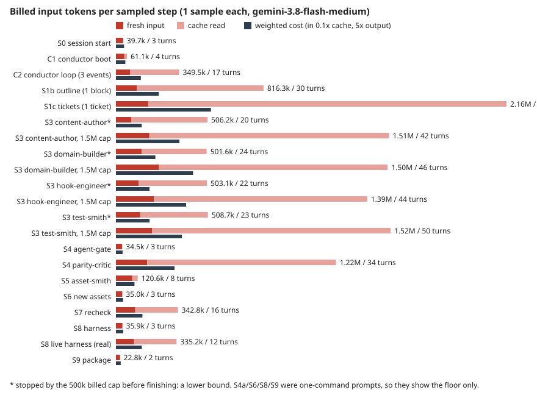
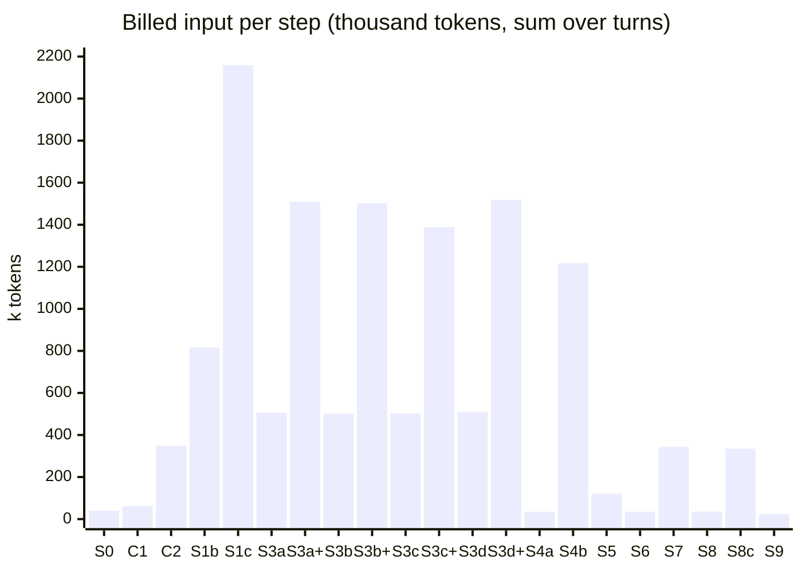

# Token audit: performance (1 sample per step)

One run per step on `agy`, model `gemini-3.8-flash-medium`, in a throwaway worktree of `buildcraft` (S0 to S3) or a proxy mod (`redpower_2` or `example_mod`, S4 to S9). Raw data, the full event streams and agy's own logs are in `runs/`; `harness/make_report.py` rebuilds this table and the chart. Predictions to compare against: [`predictions.md`](predictions.md).

Units: *billed input* = the sum over every turn of that turn's whole context (fresh plus cache read). *Weighted cost* = fresh input + 0.1 x cache read + 5 x output (thinking is part of output). agy reports no cache-write figure, so cache writes are counted as fresh input. `*` = stopped by the 500k billed cap before the task was done. The rows marked "1.5M cap" are the same four code tickets rerun with a 3x higher cap.

| Step | Turns | Peak ctx | Billed input (sum of turns) | of which cache read | Output (thinking) | Weighted cost | Cmds / reads | Note |
|---|---|---|---|---|---|---|---|---|
| S0 session start | 3 | 14.8k | 39.7k | 0% | 1.1k (0.9k) | 44.9k | 1 / 1 |  |
| C1 conductor boot | 4 | 16.9k | 61.1k | 24% | 0.8k (0.6k) | 52.0k | 2 / 1 |  |
| C2 conductor loop (3 events) | 17 | 28.0k | 349.5k | 77% | 6.3k (4.2k) | 137.6k | 11 / 5 |  |
| S1b outline (1 block) | 30 | 45.3k | 816.3k | 85% | 10.3k (6.8k) | 236.6k | 20 / 5 |  |
| S1c tickets (1 ticket) | 50 | 74.3k | 2.16M | 91% | 29.5k (26.0k) | 525.5k | 36 / 12 |  |
| S3 content-author* | 20 | 35.7k | 506.2k | 82% | 2.9k (1.7k) | 142.5k | 12 / 7 | capped at 500k billed, task unfinished |
| S3 content-author, 1.5M cap | 42 | 57.4k | 1.51M | 87% | 6.6k (4.1k) | 350.6k | 20 / 21 | capped at 1.5M billed, task unfinished |
| S3 domain-builder* | 24 | 32.7k | 501.6k | 71% | 7.9k (6.3k) | 218.0k | 13 / 9 | capped at 500k billed, task unfinished |
| S3 domain-builder, 1.5M cap | 46 | 52.5k | 1.50M | 84% | 12.3k (7.9k) | 426.6k | 25 / 15 | capped at 1.5M billed, task unfinished |
| S3 hook-engineer* | 22 | 33.9k | 503.1k | 74% | 4.3k (3.0k) | 185.4k | 15 / 6 | capped at 500k billed, task unfinished |
| S3 hook-engineer, 1.5M cap | 44 | 54.0k | 1.39M | 84% | 12.0k (8.5k) | 388.0k | 26 / 13 |  |
| S3 test-smith* | 23 | 30.1k | 508.7k | 73% | 2.8k (1.6k) | 185.9k | 16 / 5 | capped at 500k billed, task unfinished |
| S3 test-smith, 1.5M cap | 50 | 49.8k | 1.52M | 86% | 6.6k (3.7k) | 365.1k | 36 / 12 | capped at 1.5M billed, task unfinished |
| S4 agent-gate | 3 | 11.9k | 34.5k | 0% | 0.5k (0.4k) | 36.8k | 1 / 0 |  |
| S4 parity-critic | 34 | 50.8k | 1.22M | 85% | 9.3k (6.3k) | 323.8k | 21 / 12 |  |
| S5 asset-smith | 8 | 17.4k | 120.6k | 24% | 1.8k (1.2k) | 102.5k | 3 / 4 |  |
| S6 new assets | 3 | 12.3k | 35.0k | 0% | 0.8k (0.7k) | 39.1k | 2 / 0 |  |
| S7 recheck | 16 | 36.2k | 342.8k | 68% | 3.2k (2.3k) | 146.5k | 8 / 7 |  |
| S8 harness | 3 | 13.0k | 35.9k | 0% | 0.9k (0.7k) | 40.3k | 1 / 0 |  |
| S8 live harness (real) | 12 | 42.7k | 335.2k | 70% | 3.9k (1.5k) | 143.1k | 3 / 6 |  |
| S9 package | 2 | 11.7k | 22.8k | 0% | 0.7k (0.6k) | 26.3k | 1 / 0 |  |

## What the numbers say

1. **Turns, not context size, drive the bill.** Peak context never passed 75k, far below the 200k the tickets are sized for. S1c reached 2.16M billed input at a 74k peak because it ran 50 turns. The cost is roughly turns x average context. Cutting turns cuts the bill more than trimming what is loaded.
2. **There is a flat floor of about 11.1k on every first turn**, for every role. It is the agent's system prompt and tools, and the role and skill files come on top as `read_file` calls. In S1c that floor alone is 50 x 11k = 0.55M, a quarter of the run.
3. **Caching works and hides most of the input.** 68% to 91% of billed input in the longer runs was cache read. The weighted cost is 3x to 6x lower than the raw figure: S1c is 2.16M billed but about 0.53M weighted. If your plan counts raw tokens, not weighted ones, the raw column is the one that matters.
4. **Thinking is the largest weighted line in the long runs.** In S1c, 26k of 29.5k output tokens were thinking, and output is about 28% of weighted cost. In S1b, S3b and S4b it is also most of the output.
5. **Discovery commands are the biggest avoidable waste.** Of the 152 shell commands across all runs, 66 (43%) were directory listings, recursive `Get-ChildItem` or `git status` sweeps. `AGENTS.md` says to use `make fleet-context` and `make spec-show`, not `ls`/`find` sweeps, but flash-medium did not follow it. Each of these returns up to agy's output cap of about 10k characters (2.5k tokens) into context, and that is then re-paid on every later turn. S1c also read `Makefile` and `scripts/fleet/beads.py` (and ran `git log -p` on it) to find out how a command works, which the rules also forbid.
6. **No agent read the whole codebase.** Each run did only 0 to 12 file reads. Java was read through `make java-outline` and `make java-show` in S1b, as designed. The problem is exploration by command, not bulk reads.
7. **Long steps are the spec-writers, the parity-critic and every code ticket.** S1c (2.16M), S3 tickets (1.4M to 1.5M and not always finished), S4b (1.22M) and S1b (0.82M). The 200k-token ticket size does not match the cost: a "200k" code ticket billed about 1.5M input tokens at a 50k to 57k peak, because it ran 42 to 50 turns. Two of four tickets did not finish within 1.5M, and the content-author wrote nothing in 42 turns, spending them on `read_file` (21 reads) and listings.
8. **The fixed per-agent start-up is small.** S0, C1 and the one-command steps cost 23k to 61k each. Boot costs are not the problem; the long loops are.

## Fan-out (an extrapolation, not a measurement)

If the fleet starts N agents at once and each does a ticket like the S3 code tickets, S4b or S1c (1.2M to 2.2M billed input, 0.3M to 0.5M weighted), then 10 agents in parallel spend 12M to 22M billed input (3M to 5M weighted) within minutes, and a ticket that does not finish gets restarted, paying its floor again. That matches the way your budget disappeared in 20 minutes. The conductor proxy (C2) added about 100k billed per report event, so a conductor handling a mod's tickets in one context is a second, steadily growing cost on top of the workers.

## Hypotheses against the results

| | Hypothesis | Result |
|---|---|---|
| H1 | Fixed floor paid every turn | Confirmed, and it is 11k, not the 15-25k I predicted |
| H2 | Turns, not context, drive cost | Confirmed |
| H3 | Conductor growth | Partly: about 100k billed per event in a 3-event proxy, plus 61k boot; a full loop is not measured |
| H4 | Fan-out multiplies it | Supported by arithmetic only |
| H5 | Command output enters context unfiltered | Not supported for build output (3% of new context); listing sweeps do hit agy's 10k-character output cap |
| H6 | Same Java read twice | Not tested |
| H7 | Large skills loaded in full | Partly: `mod-spec` (12 KB) was read in full by content-author |

## Limits of this audit

- **One sample per step, one model.** `gemini-3.8-flash-medium` was chosen by you, not the fleet's usual first model, so absolute numbers will differ and one run says nothing about spread.
- **Short samples.** S4a, S6, S8 and S9 were single-command prompts, so they show only the floor. The real agent-gate and harness steps cost far more when something fails.
- **The first harness sample failed on missing game resources**; fixed by linking the prepared resources, and the real run (S8c) passed.
- **Some S3 runs are lower bounds.** Three of four stopped at 500k and two of four at 1.5M before finishing.
- **Proxy mods.** S4 to S9 ran on `redpower_2` and `example_mod`, not `buildcraft`.
- **No Beads writes.** The prompts forbade `bd`, so ticket filing and report ingestion are unmeasured.

## Second batch: the unmeasured items (run after the first report)

| Sample | Result |
|---|---|
| **S3 code tickets, 1.5M cap** | Only the hook-engineer finished (1.39M billed, 44 turns, 4 files written). The domain-builder finished its task in 46 turns, but hit the cap just after (1.50M, 2 unit tests passed). The content-author (1.51M, 42 turns) and the test-smith (1.52M, 50 turns) **hit 1.5M with the task unfinished**; the content-author wrote no file in 42 turns, it only read and searched. So the smallest code ticket costs about 1.4M to 1.5M billed input (0.35M to 0.43M weighted) when it finishes, and some do not finish. |
| **C2 conductor loop** | 17 turns, 349k billed, 28k peak for 3 read-only report events plus status commands: about **100k billed per event**, once the 13k-token conductor file and boot (C1, 61k) are paid. With 525 code items in `redpower_2` as a scale reference, a conductor handling hundreds of events in one context would pass the 200k wrap-up at roughly 200 events, with the context re-paid on every turn. Not measured end to end: this is a three-event proxy. |
| **S8 live harness (real)** | **Passed**: 85 actions run, 3 skipped, 0 errors, 1/1 blocks OK, 2/2 creative items found, in 97 s of game time. The agent used 12 turns and 335k billed (143k weighted); the game's own logs were read through `read_file` (42.7k peak). So the environment works with Minecraft 26.3 and the linked prepared resources, and the harness itself is cheap in tokens (the earlier one-command S8 failed on the missing resources). Wall time was 773 s. |

Cleanup: every worktree from this batch was removed, `git worktree list` shows only the main checkout, and the old `rekkit-audit-*` folders are gone.

## Finer attribution (all 21 samples, from the event streams)

`harness/attribute.py` splits each turn's context growth (minus what the model wrote) across the tool calls between the two turns, and `harness/extras.py` finds repeated reads. Raw data: `attribution.json`.

| Tool class | Calls | Tokens added to context | Per call | Share |
|---|---|---|---|---|
| read_file | 141 | 193.7k | 1.37k | 51% |
| dir listing sweep | 110 | 81.1k | 0.74k | 21% |
| text search | 56 | 53.9k | 0.96k | 14% |
| make java-show | 16 | 12.8k | 0.80k | 3% |
| build/test/gate | 30 | 11.9k | 0.40k | 3% |
| other command | 34 | 6.0k | 0.18k | 2% |
| other make | 16 | 5.5k | 0.35k | 1% |
| model/system (no tool) | - | 4.9k | 0.00k | 1% |
| git inspect | 9 | 4.6k | 0.51k | 1% |
| make java-outline | 2 | 3.1k | 1.57k | 1% |
| write/edit | 9 | 1.6k | 0.18k | 0% |
| make spec/context | 2 | 1.1k | 0.54k | 0% |

- **The tools put about 400k tokens of new content into context across the 21 runs, but the runs billed far more** (about 6.9M for the first 15 alone): every token that enters context is paid about 26 times on average (10x in the shortest runs, 34x in S1c).
- **`read_file` is 51% of new context (141 calls, about 1.4k each) and directory sweeps are 21% (110 calls).** `make java-show`, the designed way to read Java, is only 3%.
- **Build, test and gate output is small (3%, 30 calls).** Hypothesis H5 (cargo, clippy and e2e output flooding context) is not supported at this size; the cost is discovery by listing and reading.
- **Repeats:** S1c read `scripts/fleet/beads.py` 6 times and ran `fleet-tickets` 7 times (it failed in the worktree on a git-common-dir error, so the agent spent turns on an environment problem that comes from my worktree setup, not your repo; treat S1c as inflated by that). The parity-critic ran the same search or listing 2 to 3 times. S7 read `scripts/contract_check.py` 4 times. In the 1.5M reruns the code roles opened files such as `scripts/fleet/guard.py` and `scripts/e2e_harness.py` to learn how a command works, which the rules forbid.

## Follow-ups to fix later

- **Run `bd setup agy`, `bd setup claude` and `bd setup opencode`** (one per tool the fleet uses) so each agent starts with the Beads context built in, instead of getting it through ad hoc commands. A search of `.agents/`, `AGENTS.md`, `CLAUDE.md`, `setup.sh` and `scripts/` found no `bd setup` today. This is untested: the audit did not measure it, and its effect on tokens is unknown. A good check after the change is the S0 and C1 samples (first-turn floor and boot cost) and S1c (how many discovery commands the agent still runs).
