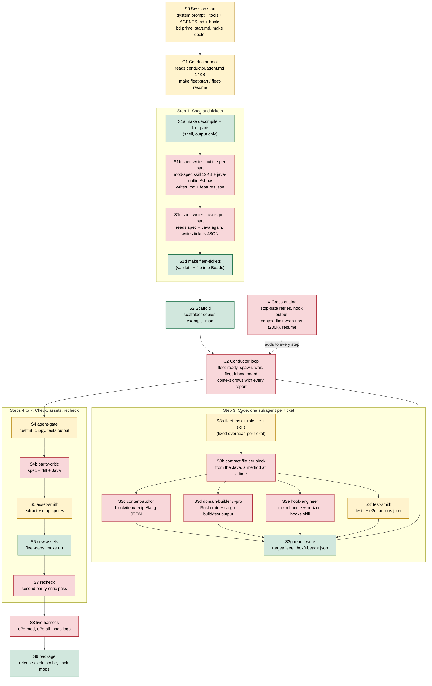
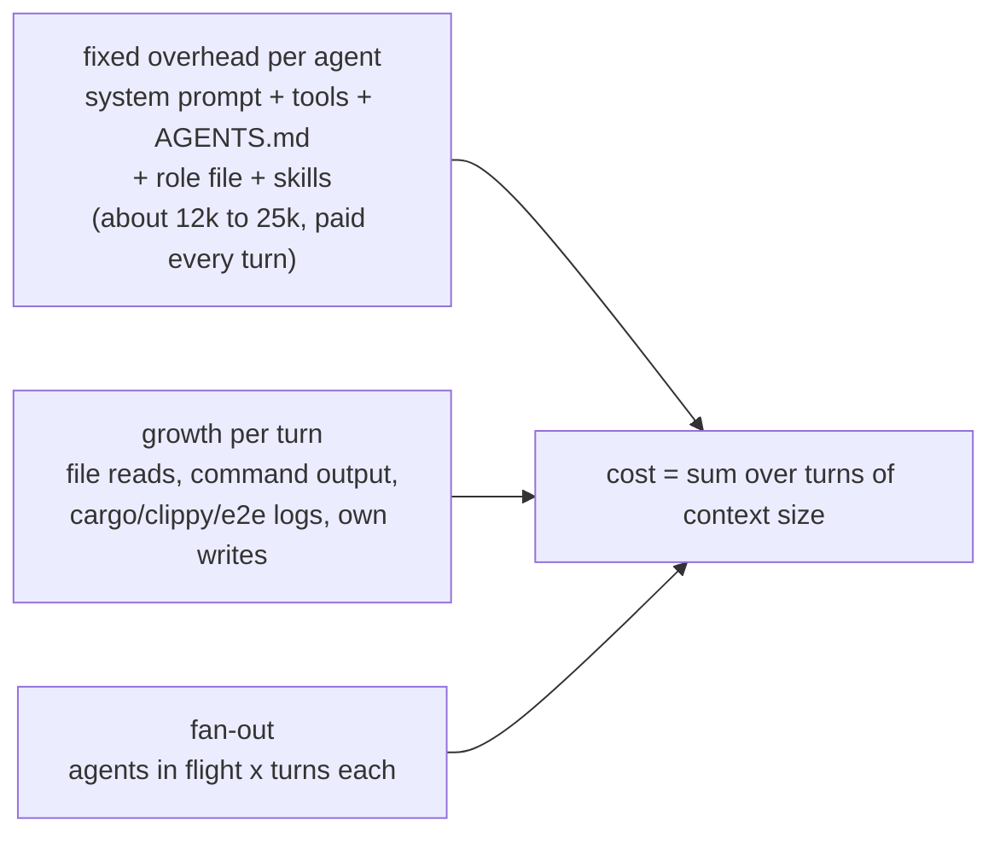

# Token audit: process map

Every step an agent takes to port one mod (`/conductor` or `make agy`), with the files and commands that put tokens into its context. Red = predicted heavy, amber = medium, green = light. Predicted ranges are in [`predictions.md`](predictions.md); measured ones in `performance.md` once sampled.

## Where context is paid

Every turn re-sends the whole context, so a step costs roughly the sum of the context size over its turns, not its final context size.

