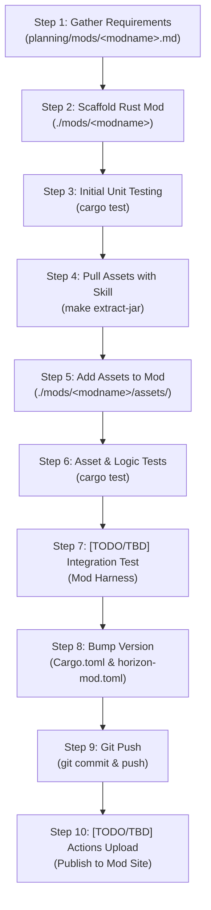

# Java Mod to Horizon Rust Porting Workflow

## 1. Goal & Context

The goal of **Rekkit** is to port all classic Java Minecraft mods (Tekkit Classic 1.2.5, Direwolf20 1.4.7, etc.) into high-performance, native Rust mods compatible with the **[Horizon](file:///C:/Users/legoc/Desktop/Code_Projects/rekkit/horizon)** engine.

> [!IMPORTANT]
> **Horizon Readiness Notice:**
> The Horizon engine's modding runtime (`horizon-mods`, WebAssembly/WIT component model and server mod API `0.3`) is currently in active development. Horizon is not yet ready to load and execute external third-party mods end-to-end.
>
> While we are waiting on Horizon development to finish enough to start live engine integration, our strategy is to build, verify, and package the complete domain logic, state machines, math, data structures, and assets for each mod in isolated crates under [`./mods/<modname>`](file:///C:/Users/legoc/Desktop/Code_Projects/rekkit/mods). Once Horizon's mod loader stabilizes, these mods can be plugged in immediately with minimal adaptation.

---

## 2. Complete Mod Conversion Lifecycle



---

## 3. Step-by-Step Execution Guide

### Step 1: Gather Requirements & Document Specification
* **Target:** [`planning/mods/<modname>.md`](file:///C:/Users/legoc/Desktop/Code_Projects/rekkit/planning/mods)
* Reverse-engineer the original Java mod (decompiled JAR, wiki documentation, configuration files).
* Document:
  * Complete block and item registries.
  * Mechanics, formulas (e.g. EU/MJ rates, tick timers, EMC values).
  * State machines, multiblock geometry, bounding boxes, network packets.
  * Known hazards (explosions, meltdowns, timeouts).
* *Reference existing specs:* See [planning/mods/equivalent_exchange_2.md](file:///C:/Users/legoc/Desktop/Code_Projects/rekkit/planning/mods/equivalent_exchange_2.md) or [planning/mods/redpower_2.md](file:///C:/Users/legoc/Desktop/Code_Projects/rekkit/planning/mods/redpower_2.md).

### Step 2: Scaffold Rust Mod in `./mods/<modname>`
* **Target Directory:** `./mods/<modname>/`
* Create standard Rust crate files:
  1. `Cargo.toml`: Package definition, dependencies (`serde`, `serde_json`, etc.).
  2. `horizon-mod.toml`: Horizon mod manifest conforming to Horizon's API (`id`, `name`, `version`, `api = "0.2"`, `side = "server"`).
  3. `src/lib.rs`: Core domain models, state machines, and lifecycle hooks (`HorizonMod` trait).
* *Concrete Example:* See [`mods/example_mod/Cargo.toml`](file:///C:/Users/legoc/Desktop/Code_Projects/rekkit/mods/example_mod/Cargo.toml) and [`mods/example_mod/src/lib.rs`](file:///C:/Users/legoc/Desktop/Code_Projects/rekkit/mods/example_mod/src/lib.rs).

### Step 3: Initial Unit & Subsystem Testing
* Write tests in `tests/` covering:
  * Channel hashing and isolation.
  * Inventory and state serialization.
  * Math and ticking algorithms.
* Run tests:
  ```bash
  cargo test --manifest-path mods/<modname>/Cargo.toml
  ```

### Step 4: Pull Assets from Original Java Mod Archive
* Use the project Claude skill `extract-jar-assets` or Makefile targets to unpack the original legacy mod JAR or ZIP.
* Legacy mods (1.2.5 / 1.4.7) do not use modern `assets/<modid>/` paths; the skill safely extracts sprites, audio, models, and scripts from legacy root folders (`gfx/`, `armor/`, `terrain/`, `lua/rom/`).
* Command:
  ```bash
  make extract-jar JAR=assets/direwolf20/mods/<modname>.jar EXTRACT_OUT=assets/extracted/<modname>
  ```

### Step 5: Add & Organize Assets in Mod Directory
* Copy relevant extracted textures, models, audio, and language files into the mod's resource layout:
  ```text
  mods/<modname>/assets/<modname>/
    ├── lang/
    │   └── en_us.json
    ├── textures/
    │   ├── blocks/
    │   ├── items/
    │   └── gui/
    └── sounds/
  ```

### Step 6: Asset Validation & Logic Tests
* Run tests to ensure:
  * Localization keys match item/block identifiers.
  * NBT/JSON data files deserialize without error.
  * Core crate tests continue to pass.
  ```bash
  cargo test --manifest-path mods/<modname>/Cargo.toml
  ```

### Step 7: [TODO / TBD] Integration Testing via Mod Harness
> [!WARNING]
> **TODO / TBD - Mod Test Harness:**
> Because Horizon cannot currently run third-party mods in an integrated server environment, we must build a dedicated **Mod Test Harness** (`crates/mod-harness` or `tests/harness`).
> - The harness will mock world chunk grids, block placement events, tile entity tick dispatches, and inventory transfers.
> - Allows end-to-end integration testing of Rust mods in headless mode prior to Horizon engine readiness.
> - *Status: Scheduled for development once base mod logic is established.*

### Step 8: Update Versioning
* Bump the semantic version in both manifests:
  * `mods/<modname>/Cargo.toml` (`version = "0.1.1"`)
  * `mods/<modname>/horizon-mod.toml` (`version = "0.1.1"`)
* Update `CHANGELOG.md` or mod documentation.

### Step 9: Git Push
* Stage and commit changes cleanly:
  ```bash
  git add mods/<modname> planning/mods/<modname>.md
  git commit -m "feat(<modname>): implement rust logic and assets v0.1.1"
  git push origin main
  ```

### Step 10: [TODO / TBD] CI/CD Actions Upload to Mod Site
> [!NOTE]
> **TODO / TBD - GitHub Actions Mod Publishing:**
> Set up automated GitHub Actions workflow (`.github/workflows/publish-mod.yml`):
> 1. Triggers on tag or release commit (`v*`).
> 2. Compiles `.wasm` or native `.hmod` archive.
> 3. Runs test suite and mod harness.
> 4. Uploads package artifacts to the Horizon mod registry / mod distribution portal.

---

## 4. Concrete Reference Implementation: `example_mod`

A working reference mod conforming to this exact workflow is provided in [`mods/example_mod`](file:///C:/Users/legoc/Desktop/Code_Projects/rekkit/mods/example_mod):

```text
mods/example_mod/
├── Cargo.toml                  # Rust package definition
├── horizon-mod.toml            # Horizon mod manifest (API 0.2 / 0.3)
├── README.md                   # Mod documentation & usage
├── src/
│   └── lib.rs                  # Frequency channels, storage state, and HorizonMod trait
├── tests/
│   └── mod_tests.rs            # 4 passing unit tests verifying isolation and serialization
└── assets/
    └── example_mod/
        └── lang/
            └── en_us.json      # Resource localization
```

### Running the Example Mod Tests
```bash
cargo test --manifest-path mods/example_mod/Cargo.toml
```
Expected output:
```text
running 4 tests
test test_mod_lifecycle_init ... ok
test test_frequency_key_indexing ... ok
test test_storage_serialization ... ok
test test_channel_isolation_public_vs_private ... ok

test result: ok. 4 passed; 0 failed; 0 ignored; 0 measured; 0 filtered out
```
