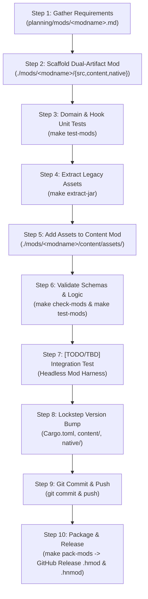

# Java Mod to Horizon Rust Porting Workflow

## 1. Goal & Architecture Context

The goal of **Rekkit** is to port classic Java Minecraft mods (Tekkit Classic 1.2.5, Direwolf20 1.4.7, Agrarian Skies 2) into high-performance, native Rust mods compatible with the **[Horizon](file:///Users/jonathanstoff/Desktop/scripts/rekkit/horizon)** engine.

> [!IMPORTANT]
> **Horizon Dual-Artifact Mod Architecture (No WebAssembly):**
> Horizon has removed its legacy WebAssembly (`.wasm`) runtime (`docs/no-wasm-docs`) and divides mods into two artifacts:
> 1. **Content Mod (`.hmod`, API `0.2`, `capabilities = ["registries"]`)**: Pure data and assets (`content/horizon-mod.toml`, `content/data/`, `content/assets/`) declaring blocks (with optional item `components`), items (with optional `crafting_remainder`), custom `mob_effect` types, recipes (including custom machine recipe types), loot tables, tags, models, and textures. **No `Cargo.toml` is permitted in `content/`** (`cargo-horizon-mod` refuses directories with `Cargo.toml`).
> 2. **Native Mod (`.hnmod`, `NATIVE_HOOKS_API = 40`)**: A source-level [horizon-mixins](https://github.com/horizon-rust/horizon-mixins) bundle (`native/horizon-native.json` + `native/mixins/<id>/horizon-mixin.toml` + `.rs` helpers) that hooks into [`crates/horizon-client/src/game/native_hooks.rs`](file:///Users/jonathanstoff/Desktop/scripts/rekkit/horizon/crates/horizon-client/src/game/native_hooks.rs).
> 3. **Pure Rust Domain Crate (`mods/<modname>/Cargo.toml` + `src/lib.rs`)**: Standalone, 100% unit-testable Rust crate housing energy networks, EMC math, state machines, and the `HorizonNativeMod` trait implementation.

### Horizon Native Hooks API Reference (Hooks 8–40)

| Hook API Level | Entrypoints in `native_hooks.rs` | Usage in Tekkit Mods |
| :--- | :--- | :--- |
| **API 8–10** | `native_register_commands`, `native_perform_command`, `native_open_menu` | Server commands (`/emc`, `/cc`) and server-side virtual chest menus. |
| **API 12** | `native_tooltip` | Dynamic item tooltips (EMC values, EU charge levels, frequency labels). |
| **API 13–14** | `native_use_item_on`, `native_use_item`, `native_destroy_block`, `native_place_block` | Wrenches, treetaps, Philosopher's Stone, wireless remotes, block placement/break hooks. |
| **API 15** | `native_block_entity`, `native_block_entity_ticks` | Creating and enabling ticking block entities (`ModBlockEntity`) when mod blocks are placed. |
| **API 16–17** | `native_block_entity_container`, `native_block_entity_tick` | Machine inventory slots (`ModContainer`), hopper/comparator compatibility, and server-side machine ticking. |
| **API 18** | `native_with_mod_block_entity`, `native_set_block_property` | Inter-block energy/item transfer (IC2 EU cables, BuildCraft pipes, RedPower wires) and block state properties (`lit`, `facing`). |
| **API 19–20** | `native_screen`, `native_screen_draw`, `native_screen_click`, `native_screen_tooltip`, `native_menu_button`, `native_insert_item`, `native_block` | Custom machine GUI screens, progress bars, buttons, tooltips, and auto-output into adjacent containers. |
| **API 21–22** | `native_right_click_block`, `native_block_spread`, `native_piston_move`, `native_explosion_detonate` | World protection, custom explosions (Nuclear Reactors, Nova Catalysts), and fluid/piston interactions. |
| **API 23–26** | `native_level_tick_pre/post`, `native_set_block`, `native_play_sound`, `native_config_dir` | Per-dimension ticks, world block placement/digging (Quarries, Fillers, Miners, Block Breakers, Frames), machine audio, and `config/<mod>.toml` files. |
| **API 27–30** | `native_health_hud`, `native_block_in_tag`, `native_item_in_tag`, `native_interact_entity`, `native_left_click_block` | Armor/Jetpack HUD bars, runtime `#c:ores`/`#c:ingots` tag queries (replacing Forge `OreDictionary`), entity interactions, and left-click block hooks (Barrels). |
| **API 31–35** | `native_player_tick`, `native_update_shape`, `native_schedule_block_tick`, `native_random_tick`, `native_tick_block`, `native_commands` | Flight/Jetpack/Solar Helmet player ticks, dynamic cable/pipe/tube neighbor shape connections, Rubber Tree/Flax crop growth, and RedPower Logic Gate scheduled ticks. |
| **API 36** | `native_recipes_of_type`, `native_recipe_ingredient`, `native_recipe_result` | **Custom Machine Recipe Types** (`"type": "ic2:macerator"`, `"thermal:pulverizer"`, `"railcraft:coke_oven"`) loaded directly from `data/<ns>/recipe/*.json`. |
| **API 37** | `native_spawn_mob`, `native_mob`, `native_mobs`, `native_teleport_mob`, `native_push_mob`, `native_set_mob_health`, `native_kill_mob` | Mob spawning and physics (EE2 Interdiction Torch/Rending Gale repulsion, IC2 Tesla Coil, Soul Shards/Forestry). |
| **API 38** | `native_block_signal`, `native_is_signal_source`, `native_update_signal_neighbors` | **Custom Redstone Signal Output & Dust Connection** (RedPower Logic Gates, EU Detector Cables, BuildCraft Gates, ComputerCraft Redstone I/O). |
| **API 39** | `native_hurt_enemy`, `native_inventory_tick`, `native_carried_stack`, `native_on_equip` | **Ticking Inventory Items, Weapons & Armor** (EE2 Repair Talisman, Black Hole Band, Klein Star charging, IC2 Nano Saber & BatPack). |
| **API 40** | `native_net_send_to_player`, `native_net_send_to_server`, `native_net_from_client`, `native_net_from_server`, lifecycle events | **Custom `horizon:mod_net` Client↔Server Packets** (up to 30 KB/msg for ComputerCraft terminals, AE ME Terminals, RedPower 6502, EE2 Tablet search) + player/mob/item lifecycle hooks. |

---

## 2. Complete Mod Conversion Lifecycle



---

## 3. Step-by-Step Execution Guide

### Step 1: Gather Requirements & Document Specification
* **Target:** [`planning/mods/<modname>.md`](file:///Users/jonathanstoff/Desktop/scripts/rekkit/planning/mods)
* Reverse-engineer the original Java mod (decompiled JAR, wiki documentation, configuration files).
* Document:
  * Complete block and item registries.
  * Mechanics, formulas (e.g. EU/MJ rates, tick timers, EMC values).
  * State machines, multiblock geometry, bounding boxes, network packets.
  * Known hazards (explosions, meltdowns, timeouts).
* *Reference existing specs:* See [`planning/mods/equivalent_exchange_2.md`](file:///Users/jonathanstoff/Desktop/scripts/rekkit/planning/mods/equivalent_exchange_2.md) or [`planning/mods/redpower_2.md`](file:///Users/jonathanstoff/Desktop/scripts/rekkit/planning/mods/redpower_2.md).

### Step 2: Scaffold Dual-Artifact Rust Mod in `./mods/<modname>`
* **Target Directory:** `./mods/<modname>/`
* Create the four components of a Rekkit mod:
  1. **Domain Crate (`Cargo.toml` + `src/lib.rs`)**: Pure Rust domain models, state machines, and `HorizonNativeMod` trait implementation.
  2. **Registry Page Metadata (`horizon-registry.toml`)**: Repository metadata (`name`, `summary` <= 160 chars, `description`, `authors`, `license`) consumed by `horizon-rust/horizon-mods`.
  3. **Content Mod (`content/`)**:
     * `content/horizon-mod.toml` (`id`, `name`, `version`, `api = "0.2"`, `side = "both"`, `capabilities = ["registries"]`).
     * `content/data/<id>/horizon/block/*.json` (with optional item `components`), `content/data/<id>/horizon/item/*.json` (with optional `crafting_remainder`), and `content/data/<id>/horizon/mob_effect/*.json`.
     * `content/data/<id>/recipe/*.json` (both vanilla crafting/smelting and custom machine recipe types queried via `native_recipes_of_type`).
  4. **Native Mixin Bundle (`native/`)**:
     * `native/horizon-native.json` (`schema = 1`, `id`, `version`, `game = "26.3"`, 40-hex `horizon` & `mixins` revisions, `hooks = 40`).
     * `native/mixins/<id>/horizon-mixin.toml` & `native/mixins/<id>/hooks.rs`.

### Step 3: Initial Unit & Native Hook Testing
* Write tests in `tests/` covering:
  * Domain state machines, math, and serialization.
  * `HorizonNativeMod` lifecycle hooks (`native_block_entity`, `native_block_entity_container`, `native_block_entity_tick`, `native_screen`, `native_menu_button`).
  * Dual-artifact manifest and JSON schema validation.
* Run tests:
  ```bash
  make test-mods
  ```

### Step 4: Pull Assets from Original Java Mod Archive
* Use the `extract-jar-assets` skill or Makefile targets to unpack the original legacy mod JAR or ZIP:
  ```bash
  make extract-jar JAR=assets/direwolf20/mods/<modname>.jar EXTRACT_OUT=assets/extracted/<modname>
  ```

### Step 5: Add & Organize Assets in `content/assets/<modname>/`
* Place extracted textures, models, audio, and language files into `mods/<modname>/content/assets/<modname>/`:
  ```text
  mods/<modname>/content/assets/<modname>/
    ├── blockstates/
    ├── items/
    ├── lang/
    │   └── en_us.json
    ├── models/
    │   └── block/
    ├── textures/
    │   ├── block/
    │   ├── item/
    │   └── gui/
    └── sounds/
  ```

### Step 6: Asset Validation & Schema Checks
* Run the validation script and test suites:
  ```bash
  make check-mods MOD=<modname>
  make test-mods
  ```

### Step 7: End-to-End Integration & Compatibility Testing via Mod Harness
* **Specification & Architecture:** See [`planning/harness.md`](file:///Users/jonathanstoff/Desktop/scripts/rekkit/planning/harness.md) and [`scripts/e2e_harness.py`](file:///Users/jonathanstoff/Desktop/scripts/rekkit/scripts/e2e_harness.py).
* Executes a two-phase verification matrix driving the live `horizon-client` binary via `horizon-ctl` (`--offscreen` + `HORIZON_NO_AUDIO=1`):
  1. **Phase 1 — Isolated Mod Run (`make e2e-mod MOD=<modname>`)**: Boots Horizon with only `<modname>` loaded, spawns all of its blocks and items into a test world, and runs the **7-Stage Exhaustive Action Matrix** (give/tooltip check, world grid placement, item-on-block interactions, custom GUI open/button clicks/screenshots, server tick & hopper neighbor I/O, recipe verification, and survival block breaking/loot drop verification).
  2. **Phase 2 — All-Mods Compatibility Run (`make e2e-all-mods`)**: Audits cross-mod namespace/tag/revision rules, then boots Horizon with **all Rekkit mods loaded simultaneously**, places every block from every mod across dedicated 32×32 world plots, and re-runs the full 7-stage action suite concurrently to verify compatibility.
* Run both phases together (or use `DRY_RUN=1` for fast pre-flight action plan generation):
  ```bash
  make integration-test DRY_RUN=1
  make integration-test
  ```

### Step 8: Update Versioning in Lockstep
* Bump the semantic version identically across:
  * `mods/<modname>/Cargo.toml`
  * `mods/<modname>/content/horizon-mod.toml`
  * `mods/<modname>/native/horizon-native.json`
  * `mods/<modname>/native/mixins/<modname>/horizon-mixin.toml`
* Verify lockstep alignment with `make check-mods MOD=<modname>`.

### Step 9: Git Push
* Stage and commit changes cleanly:
  ```bash
  git add mods/<modname> planning/mods/<modname>.md
  git commit -m "feat(<modname>): implement rust logic, content, and native hooks v0.1.1"
  git push origin main
  ```

### Step 10: Package & Publish to Horizon Mod Registry via GitHub Releases
* Build deterministic `.hmod` and `.hnmod` release bundles:
  ```bash
  make pack-mods MOD=<modname>
  ```
* Produces:
  * `mods/<modname>/target/horizon-mod/<modname>.hmod` (Content Mod)
  * `mods/<modname>/target/horizon-mod/<modname>.hnmod` (Native Mod)
* Releasing is automatic once the push reaches `main`: [`.github/workflows/release-mods.yml`](../.github/workflows/release-mods.yml) finds every mod (but `example_mod`) whose version has no release yet, runs its tests, packs it, signs both files with the `MINISIGN_SECRET_KEY` secret (checked against `minisign.pub`), and publishes the GitHub Release `<modname>-<version>` with `<modname>.hmod`, `<modname>.hnmod` and their `.minisig` files. Horizon's registry (`horizon-rust/horizon-mods`) reads new releases of a listed project's repository within the hour.
* The same workflow fails (on pull requests too) when a mod's `content/`, `native/` or `src/` changed since its last release but the version did not (Step 8). Check locally with `python3 scripts/release_plan.py --exclude example_mod`.
* Once per mod, a person lists it at [playhorizon.dev/mods/submit](https://playhorizon.dev/mods/submit) (repository, page, the key in `minisign.pub`); a Horizon reviewer reads it before it is published.

---

## 4. Concrete Reference Implementation: `example_mod`

A complete, working reference mod conforming to this dual-artifact architecture is located in [`mods/example_mod`](file:///Users/jonathanstoff/Desktop/scripts/rekkit/mods/example_mod):

```text
mods/example_mod/
├── Cargo.toml                                  # Rust domain crate manifest
├── horizon-registry.toml                       # Horizon Mod Registry page metadata
├── README.md                                   # Mod documentation & usage
├── src/
│   └── lib.rs                                  # Frequency channels & HorizonNativeMod (API 40)
├── tests/
│   └── mod_tests.rs                            # 6 passing tests (domain, native hooks, manifests)
├── content/                                    # Content Mod (.hmod, API 0.2, no Cargo.toml)
│   ├── horizon-mod.toml
│   ├── assets/example_mod/...
│   └── data/example_mod/horizon/{block,item,mob_effect}/...
└── native/                                     # Native Mod (.hnmod, NATIVE_HOOKS_API = 40)
    ├── horizon-native.json
    └── mixins/example_mod/
        ├── horizon-mixin.toml
        └── hooks.rs
```
