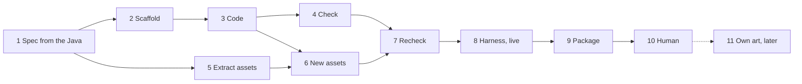

# Java Mod to Horizon Rust Porting Workflow

## 1. Goal & Architecture Context

The goal of **Rekkit** is to port classic Java Minecraft mods (Tekkit Classic 1.2.5, Direwolf20 1.4.7, Agrarian Skies 2) into high-performance, native Rust mods compatible with the **[Horizon](file:///Users/jonathanstoff/Desktop/scripts/rekkit/horizon)** engine.

> [!IMPORTANT]
> **Horizon Dual-Artifact Mod Architecture (No WebAssembly):**
> Horizon has removed its legacy WebAssembly (`.wasm`) runtime (`docs/no-wasm-docs`) and divides mods into two artifacts:
> 1. **Content Mod (`.hmod`, API `0.2`, `capabilities = ["registries"]`)**: Pure data and assets (`content/horizon-mod.toml`, `content/data/`, `content/assets/`) declaring blocks (with optional item `components`), items (with optional `crafting_remainder`), custom `mob_effect` types, recipes (including custom machine recipe types), loot tables, tags, models, and textures. **No `Cargo.toml` is permitted in `content/`** (`cargo-horizon-mod` refuses directories with `Cargo.toml`).
> 2. **Native Mod (`.hnmod`, `NATIVE_HOOKS_API = 40`)**: A source-level [horizon-mixins](https://github.com/horizon-rust/horizon-mixins) bundle (`native/horizon-native.json` + `native/mixins/<id>/horizon-mixin.toml` + `.rs` helpers) that hooks into [`crates/horizon-client/src/game/native_hooks.rs`](file:///Users/jonathanstoff/Desktop/scripts/rekkit/horizon/crates/horizon-client/src/game/native_hooks.rs).
> 3. **Pure Rust Domain Crate (`mods/<modname>/Cargo.toml` + `src/lib.rs`)**: Standalone, 100% unit-testable Rust crate housing energy networks, EMC math, state machines, and the `HorizonNativeMod` trait implementation.

### Horizon Native Hooks API Reference (Hooks 8–40)

| Hook API Level | Entrypoints in `native_hooks.rs` | Usage in Tekkit Mods |
| :--- | :--- | :--- |
| **API 8–10** | `native_register_commands`, `native_perform_command`, `native_open_menu` | Server commands (`/emc`, `/cc`) and server-side virtual chest menus. |
| **API 12** | `native_tooltip` | Dynamic item tooltips (EMC values, EU charge levels, frequency labels). |
| **API 13–14** | `native_use_item_on`, `native_use_item`, `native_destroy_block`, `native_place_block` | Wrenches, treetaps, Philosopher's Stone, wireless remotes, block placement/break hooks. |
| **API 15** | `native_block_entity`, `native_block_entity_ticks` | Creating and enabling ticking block entities (`ModBlockEntity`) when mod blocks are placed. |
| **API 16–17** | `native_block_entity_container`, `native_block_entity_tick` | Machine inventory slots (`ModContainer`), hopper/comparator compatibility, and server-side machine ticking. |
| **API 18** | `native_with_mod_block_entity`, `native_set_block_property` | Inter-block energy/item transfer (IC2 EU cables, BuildCraft pipes, RedPower wires) and block state properties (`lit`, `facing`). |
| **API 19–20** | `native_screen`, `native_screen_draw`, `native_screen_click`, `native_screen_tooltip`, `native_menu_button`, `native_insert_item`, `native_block` | Custom machine GUI screens, progress bars, buttons, tooltips, and auto-output into adjacent containers. |
| **API 21–22** | `native_right_click_block`, `native_block_spread`, `native_piston_move`, `native_explosion_detonate` | World protection, custom explosions (Nuclear Reactors, Nova Catalysts), and fluid/piston interactions. |
| **API 23–26** | `native_level_tick_pre/post`, `native_set_block`, `native_play_sound`, `native_config_dir` | Per-dimension ticks, world block placement/digging (Quarries, Fillers, Miners, Block Breakers, Frames), machine audio, and `config/<mod>.toml` files. |
| **API 27–30** | `native_health_hud`, `native_block_in_tag`, `native_item_in_tag`, `native_interact_entity`, `native_left_click_block` | Armor/Jetpack HUD bars, runtime `#c:ores`/`#c:ingots` tag queries (replacing Forge `OreDictionary`), entity interactions, and left-click block hooks (Barrels). |
| **API 31–35** | `native_player_tick`, `native_update_shape`, `native_schedule_block_tick`, `native_random_tick`, `native_tick_block`, `native_commands` | Flight/Jetpack/Solar Helmet player ticks, dynamic cable/pipe/tube neighbor shape connections, Rubber Tree/Flax crop growth, and RedPower Logic Gate scheduled ticks. |
| **API 36** | `native_recipes_of_type`, `native_recipe_ingredient`, `native_recipe_result` | **Custom Machine Recipe Types** (`"type": "ic2:macerator"`, `"thermal:pulverizer"`, `"railcraft:coke_oven"`) loaded directly from `data/<ns>/recipe/*.json`. |
| **API 37** | `native_spawn_mob`, `native_mob`, `native_mobs`, `native_teleport_mob`, `native_push_mob`, `native_set_mob_health`, `native_kill_mob` | Mob spawning and physics (EE2 Interdiction Torch/Rending Gale repulsion, IC2 Tesla Coil, Soul Shards/Forestry). |
| **API 38** | `native_block_signal`, `native_is_signal_source`, `native_update_signal_neighbors` | **Custom Redstone Signal Output & Dust Connection** (RedPower Logic Gates, EU Detector Cables, BuildCraft Gates, ComputerCraft Redstone I/O). |
| **API 39** | `native_hurt_enemy`, `native_inventory_tick`, `native_carried_stack`, `native_on_equip` | **Ticking Inventory Items, Weapons & Armor** (EE2 Repair Talisman, Black Hole Band, Klein Star charging, IC2 Nano Saber & BatPack). |
| **API 40** | `native_net_send_to_player`, `native_net_send_to_server`, `native_net_from_client`, `native_net_from_server`, lifecycle events | **Custom `horizon:mod_net` Client↔Server Packets** (up to 30 KB/msg for ComputerCraft terminals, AE ME Terminals, RedPower 6502, EE2 Tablet search) + player/mob/item lifecycle hooks. |

---

## 2. The port process (one mod at a time)

Every mod goes through these 11 steps, one Beads story each under the mod's epic (`make fleet-status MOD=<id>`; the board in `planning/fleet-board.md` is generated from Beads). Independent work runs in parallel; each step's sign-off waits for the ones before it.



| # | Step | What happens | Who | Done when |
|---|---|---|---|---|
| 1 | **Spec and tickets from the Java** | `make decompile JAR=<archive>` (pinned Vineflower; `assets/decompiled/`, gitignored), for every version of the mod in our packs (the port merges them: every feature of any version; a shared feature from the newest). (a) One spec-writer maps the mod from the class outline and the registry: `planning/mods/<id>.md` (overview, systems, registry, recipes, hazards, hooks) and `<id>.features.json` with every block, item and subsystem. (b) `make fleet-parts` splits the decompiled code into parts; one spec-writer per part, 2 at a time, reads its part's Java once and writes its outline (`planning/mods/<id>.parts/<part>.md`), its attributes with test levels (`<part>.features.json`) and its tickets (`planning/mods/<id>.tickets/<part>.json`: aimed at 200k tokens of work, at most 6 files and 8 reads each, role, covers, files, order). (c) `make fleet-tickets` merges the parts into the spec and outline, validates them together (sizes, order, files two tickets edit at once, coverage) and files them in Beads with their dependencies. | spec-writer | tickets filed, `make fleet-tickets CHECK=1` clean |
| 2 | **Scaffold** | The `mods/example_mod` layout, version 0.1.0, the same pinned revisions. | scaffolder | it builds; `make check-mods` passes |
| 3 | **Code** | `make fleet-dispatch` starts a fresh headless agent per ready ticket (`make fleet-ready`: every ticket it is after is closed), of the ticket's role, 2 at a time, a role's first ticket alone. Each works from its brief (`make fleet-task`: the spec sections and Java methods its ticket names, its files and templates, the checks), writes the contract file of what it covers first, then builds it. An agent stops at 60 turns or 500k tokens billed with a partial report; a fresh one continues, and a ticket two could not finish is split. | the ticket's role | every ticket closed |
| 4 | **Check** | Syntax and logic: `make agent-gate MOD=<id>` (rustfmt, clippy `-D warnings`, tests, `rustfmt` on the mixin helpers, check-mods, harness dry run) and a review of the Rust against the spec and the Java. Each finding is a bug for the owning role. | parity-critic | gate passes, `VERDICT: pass` |
| 5 | **Extract assets** | The original's art and sound from the **client** build (`assets/tekkit/client/mods/`; Tekkit's server ports in `assets/tekkit/mods/` have none), sliced from sprite sheets, every file in `asset-map.json` with `origin: original` and the `credits`. Runs beside steps 2–4. | asset-smith | every block and item mapped |
| 6 | **New assets** | `make fleet-gaps MOD=<id>` lists what 26.3 needs that the original never had (blockstates, models, item model definitions, particle textures, effect icons, split sprite sheets, placeholders). Only those get new art: SVG or `.pixels` in `mods/<id>/art/`, built by `make art MOD=<id>` at the originals' size (16 px; effect icons 18) and palette, tagged `origin: generated` for review. No modernising. | asset-smith | `make check-mods MOD=<id> COMPLETE=1` passes |
| 7 | **Recheck** | Everything again on the whole mod: the gate, the completeness check, `make art ARGS=--check`, and a full review of code, content and `asset-map.json`. | parity-critic | clean |
| 8 | **Harness (live)** | `make e2e-mod MOD=<id>` and `make e2e-all-mods`: every block placed by `/setblock` **and by a player**, in **every blockstate variant**, **every item and block item found in the mod's creative tabs** in the creative inventory, through all 7 stages, with **no WARN/ERROR/panic** in the game log beyond `planning/harness-allowed-warnings.txt` (a person's list). Horizon is built and run alone first (`make horizon-baseline`, at `make fleet-start`): what fails the same way without the mod is Horizon's (exit 3, `make horizon-status`), filed as a `horizon` bug, and does not hold the mod up. | compat-auditor | every block's harness feature closed |
| 9 | **Package** | The version is already one patch past the last commit (`make version-sync` bumps a mod and `rekkit_core` once when they change; later work is bundled in). Local commit (with any `rekkit_core` change, the board and `.beads/issues.jsonl`), `make pack-mods`. | release-clerk | committed and packed |
| 10 | **Human** | The conductor ends with `DONE, CHECK OUT THE PROGRESS: make play MOD=<id>`. A person plays it, reviews, and pushes; `.github/workflows/release-mods.yml` signs and publishes a **pre-release** while original assets remain (`.agents/release.md`). | you | pushed |
| 11 | **Own art** | Later: replace every original asset with our own; then full releases reach Horizon's registry. Deferred until a person starts it. | asset-smith | 0 original assets |

**The port is the original.** Step 1's contract (`planning/mods/<id>.features.json`, from the Java: shapes, facing, face and item sprites, GUI slots, stack sizes, behaviour scenarios) is what every later step is checked against: `make contract-check MOD=<id>` statically (pixel for pixel against the original sheets), the harness live (outlines, GUI slot positions, scenarios). `make fleet-contract MOD=<id>` files each difference as a bug under the step that fixes it.

**Complete, ready for a human** = steps 1–9 closed and no contract difference. The conductor's stop hook holds it to that (agy, Claude Code); `make fleet-next` relaunches any agent until it is (`.agents/fleet-plan.md` §9).

## 3. Who writes what

- **Beads**: only the conductor (`bd`, `make fleet-*`, `make board`). Every role subagent starts with `make fleet-task BEAD=<id> ROLE=<role>` and ends by writing `target/fleet/inbox/<bead>.json`; `make fleet-inbox` files those reports (comments, closed beads, follow-ups as new beads), so no subagent's work is lost.
- **Engine gaps**: Beads bugs labelled `horizon` (`bd list --label horizon`), never edits under `horizon/`.
- **The accepted-warnings list** (`planning/harness-allowed-warnings.txt`): a person only.
- Paths per role: `.agents/fleet-plan.md` §3.

## 4. Concrete Reference Implementation: `example_mod`

A complete, working reference mod conforming to this dual-artifact architecture is located in [`mods/example_mod`](file:///Users/jonathanstoff/Desktop/scripts/rekkit/mods/example_mod):

```text
mods/example_mod/
├── Cargo.toml                                  # Rust domain crate manifest
├── horizon-registry.toml                       # Horizon Mod Registry page metadata
├── README.md                                   # Mod documentation & usage
├── src/
│   └── lib.rs                                  # Frequency channels & HorizonNativeMod (API 40)
├── tests/
│   └── mod_tests.rs                            # 6 passing tests (domain, native hooks, manifests)
├── content/                                    # Content Mod (.hmod, API 0.2, no Cargo.toml)
│   ├── horizon-mod.toml
│   ├── assets/example_mod/...
│   └── data/example_mod/horizon/{block,item,mob_effect}/...
└── native/                                     # Native Mod (.hnmod, NATIVE_HOOKS_API = 40)
    ├── horizon-native.json
    └── mixins/example_mod/
        ├── horizon-mixin.toml
        └── hooks.rs
```
